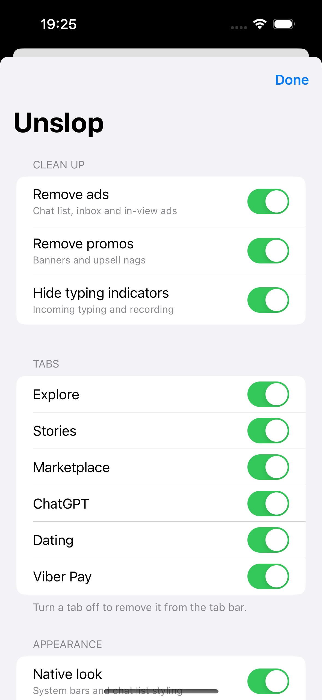
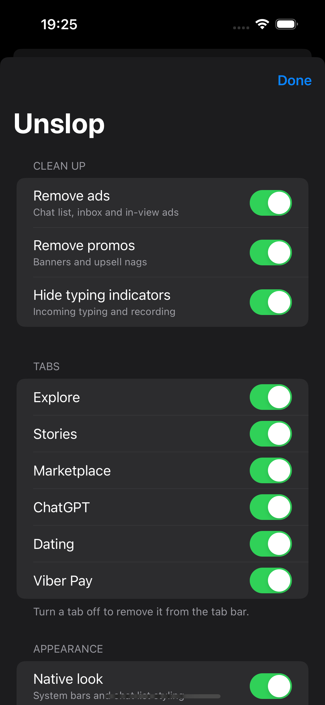

# Unslop

Cleans up Viber on iOS: no ads, no bloat tabs, no promo nags.

Unslop is a small runtime tweak (a plain dylib, no Substrate or jailbreak needed) that you inject into a decrypted Viber IPA and sign with your own certificate.

> Unaffiliated with Viber or Rakuten. Contains no Viber code. For personal use on your own device. Use at your own risk; modified apps may break at any update, and Viber's terms may restrict modification.

## What it does

| Area | Effect |
|---|---|
| Ads | Disables chat-list, business-inbox and in-view ads, and the ad-placement feature flags |
| Tabs | Hides Explore, Stories, Marketplace, ChatGPT, Dating and Viber Pay tabs. Chats, Calls and More stay |
| Promos | Blocks remote promo banners and the ChatGPT login footer |
| Typing | Hides incoming typing / recording indicators (display only) |
| Native look | System navigation/tab bars, system accent instead of Viber purple, system fonts and colors on the chat list (Light/Dark aware) |
| Native chat | Flat, borderless bubbles in system blue / neutral gray (Viber purple and gradients removed), rounded capsule input field |
| Settings | Native settings screen to toggle every feature |

Not included on purpose: hiding *your* typing or seen status. Viber ships that as a Viber Plus feature, and Unslop does not bypass paid features.

Tested target: Viber 29.6.0 (iOS 16.4+). Other versions may work, but class names can change.

## Settings

Long-press the tab bar for one second to open Unslop settings. Every feature has a switch; changes apply after you relaunch Viber (the screen has a Quit button).

<p>
  
  
</p>

`make preview` opens the settings screen in a booted iOS Simulator, so you can work on it without a device.

## Build

Requires macOS with Xcode. `ldid` is optional.

```bash
make            # builds build/Unslop.dylib
```

## Install

You need a decrypted Viber IPA (obtain it from your own app install) and a way to sign for your device.

```bash
python3 -m venv .venv && .venv/bin/pip install -r requirements.txt
.venv/bin/python scripts/inject.py Viber.ipa build/Unslop.dylib build/Viber-Unslop.ipa
```

Then sign and install with your own tooling, or from the command line. You need a development provisioning profile for your device; a wildcard profile (`TEAMID.*`) is enough.

```bash
scripts/resign.sh build/Viber-Unslop.ipa build/Viber-signed.ipa \
  embedded.mobileprovision "Apple Development: Your Name (TEAMID)"
xcrun devicectl device install app --device <UDID> build/Viber-signed.ipa
```

The app keeps the original bundle ID (`com.viber`), so **stock Viber must be uninstalled first** (iOS refuses to replace an app signed by another team, and uninstalling deletes its local data, including chats). Pass a bundle ID as the 5th argument to install alongside stock instead.

Viber stores data in an app group that a re-signed copy cannot hold. Unslop redirects the app group container into the app's own sandbox, and `resign.sh` updates the keychain group prefix, so no special capabilities are needed. App extensions are kept, but push notifications and other special entitlements are unavailable with a development profile.

## Limitations of sideloading

Re-signing with your own certificate is a platform limit, not an Unslop bug. A development certificate cannot grant entitlements that belong to Viber's team, so a re-signed Viber has:

- **No iCloud restore.** Viber's backup lives in Viber's iCloud container. A re-signed copy cannot read or write it, so a fresh install shows chats with no history. Back up, restore and back up again only in stock Viber.
- **No push notifications.**
- **A separate install.** It replaces stock Viber (same bundle ID); uninstalling deletes local data.

**Before you install:** make a Viber backup in stock Viber, and turn off Viber auto-backup while the re-signed app is installed. An empty backup would overwrite a good one.

Installs that keep Viber's original signature and entitlements avoid these limits. Unslop itself is a plain dylib, so it works with anything that can load one (a jailbreak, or tools that inject a dylib without re-signing the app).

## Debug

Unslop logs with the prefix `[Unslop]` in the device console. A line like `missing <Class> -<selector>` means a hook target was not found in your Viber version.

## How it works

On load, Unslop replaces methods through the Objective-C runtime:

- ad manager getters (`isFeatureEnabled`, `currentAdUpdates`, ...) return empty/off
- `FeatureSwitcherImpl.isEnabled` is forced off for ad-placement flags
- `UITabBarController setViewControllers:animated:` drops blocked tabs, matched by tab provider class name
- the remote-banner presenter and typing-manager handlers become no-ops

All targets live in `Sources/Unslop.m`; edit the lists at the top to change behavior.

## Contributing

Viber updates rename things. If a hook breaks, open an issue with your Viber version and the `[Unslop]` log lines, or send a PR updating the class names. Do not attach Viber binaries or class dumps.

## License

GPL-3.0-or-later. See [LICENSE](LICENSE).
